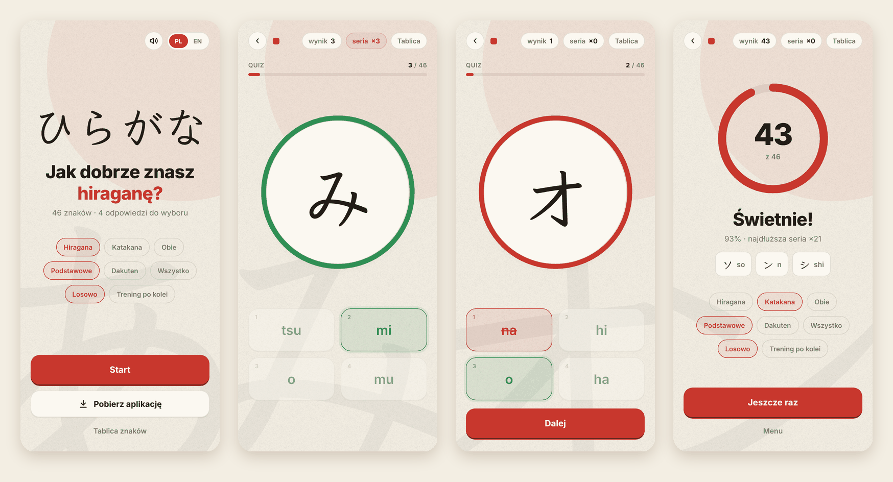
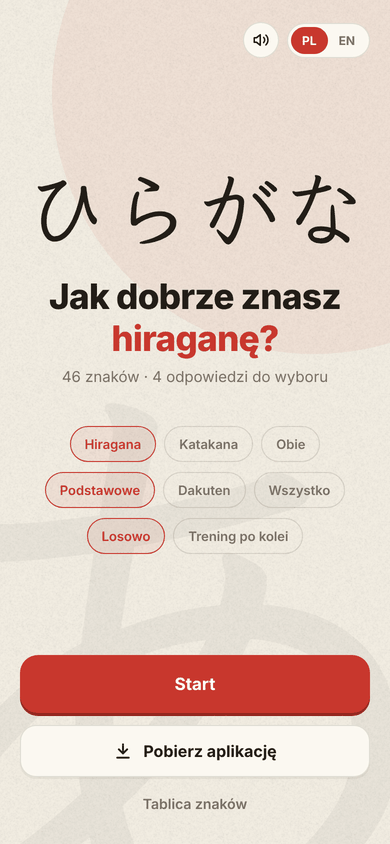
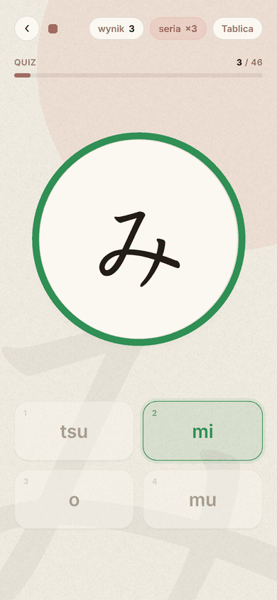
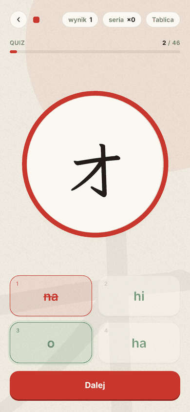
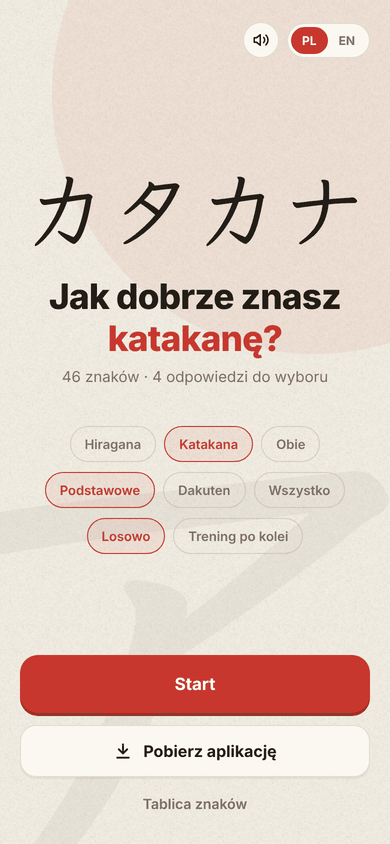
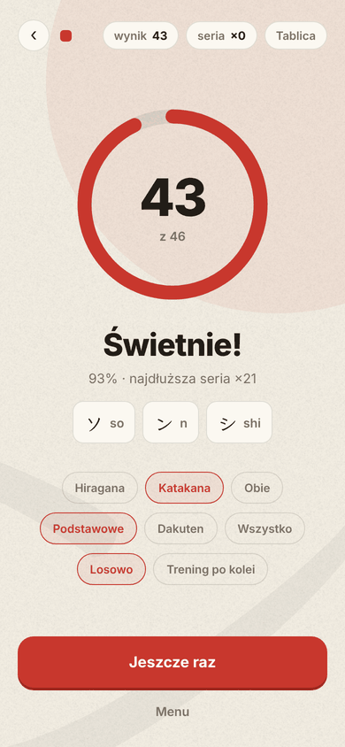
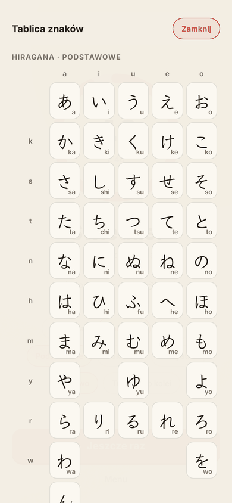

# ひらがな カタカナ · Hiragana & Katakana Quiz

**▶ Zagraj: [hiragana.pl](https://hiragana.pl)**

Darmowy quiz do nauki japońskich sylabariuszy: hiragany i katakany. Działa w przeglądarce, instaluje się na telefonie jak aplikacja i działa offline.

## Funkcje

- **Hiragana, katakana albo obie naraz.** Każde pismo ma 46 podstawowych znaków, 23 znaki z dakuten i handakuten oraz 33 kombinacje yōon (きゃ, しゅ, ちょ…).
- **Tryb losowy** albo **trening po kolei**, rząd po rzędzie jak w tablicy.
- **Wybieranie z 4 odpowiedzi** albo **wpisywanie romaji** (np. widzisz サ i wpisujesz „sa”).
- **4 odpowiedzi do wyboru.** Dobra odpowiedź podświetla się na zielono, zła na czerwono, a apka pokazuje poprawną.
- **Wynik i seria.** Po rundzie widać wynik, najdłuższą serię i listę znaków do powtórki.
- **Słówka**: fiszki z ~380 słowami (japoński → polski i odwrotnie). Apka zapamiętuje, które słowa znasz, i częściej pokazuje te sprawiające trudność.
- **Tłumaczenie**: zdanie po polsku, piszesz je po japońsku w romaji albo układasz z podpowiedzianych słów.
- **Liczby i ceny**: 4 poziomy (1–10, 11–100, do 10 000, ceny w jenach). Pytania w obie strony: wybierasz czytanie liczby albo wpisujesz liczbę z zapisu w kanie, z wyjaśnieniem nieregularnych form (さんびゃく, はっせん, よえん…).
- **Tablica znaków** z romaji dla obu pism i ściągą z partykułami (は, を, に, へ, と, の, も, が, で).
- **Tryb „Czytanie”**: słowa i zdania do przeczytania, wpisujesz romaji i od razu widzisz poprawne czytanie oraz tłumaczenie.
- **Tryb „Mylące się”**: tylko znaki, które łatwo pomylić (き/さ/ち, ね/れ/わ, シ/ツ, ソ/ン…), z ich sobowtórami jako złymi odpowiedziami.
- **Dźwięki**, które można wyciszyć.
- **Wersja polska i angielska.**
- **Instalacja na telefonie (PWA) i tryb offline.**
- **Obsługa z klawiatury:** klawisze `1`–`4` wybierają odpowiedź, `Enter` przechodzi dalej, a `Esc` wraca do menu.

## Zrzuty ekranu

| Start | Dobra odpowiedź | Zła odpowiedź |
|:---:|:---:|:---:|
|  |  |  |

| Katakana | Wynik | Tablica znaków |
|:---:|:---:|:---:|
|  |  |  |

## Instalacja na telefonie

- **iPhone (Safari):** wejdź na [hiragana.pl](https://hiragana.pl), stuknij **Pobierz aplikację** albo Udostępnij → **Do ekranu głównego** → Dodaj.
- **Android (Chrome):** wejdź na [hiragana.pl](https://hiragana.pl), stuknij **Pobierz aplikację** albo menu ⋮ → **Zainstaluj aplikację**.

## Technologie

Czysty HTML, CSS i JavaScript, bez frameworków i bez procesu budowania. Dźwięki są generowane przez Web Audio API. Czcionki Inter i Klee One są przycięte do potrzebnych znaków. Tryb offline obsługuje Service Worker, a hosting to GitHub Pages z własną domeną.

## Aktualizacja

Po każdej zmianie plików podbij wersję `CACHE` w `sw.js`, żeby zainstalowane aplikacje pobrały nową wersję.

---

**English:** a free quiz for learning Japanese hiragana and katakana. It has basic characters and dakuten, random or in-order practice, a kana chart and PL/EN versions, and it is installable as an app that works offline. Play at **[hiragana.pl](https://hiragana.pl)**.
